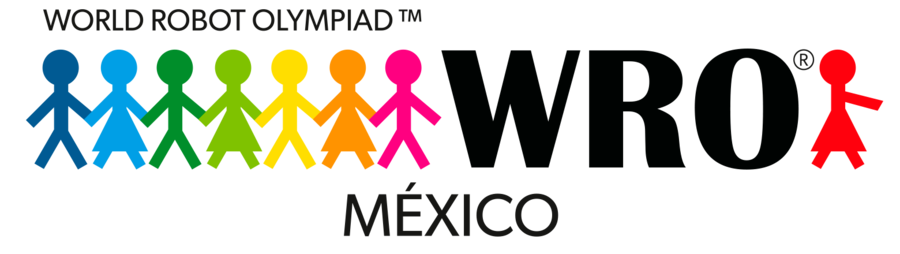

<picture>
  <source media="(prefers-color-scheme: dark)" srcset="https://raw.githubusercontent.com/wromexico/.github/main/profile/logo-dark.png">
  
</picture>

### Plataformas digitales de WRO México

Sitio web y registro de equipos, construidos para la comunidad de robótica educativa.

---

## 🤖 Qué construimos

| | |
| --- | --- |
| 🌐 **Sitio web** | Información de la competencia, categorías, reglas y recursos para equipos y familias. |
| 📝 **Registro de equipos** | Cuentas de entrenadores, equipos, participantes y documentos, con seguimiento de inscripciones. |

## 📍 Dónde encontrarnos

- Competencia y registro: [wromexico.org](https://wromexico.org)

 

WRO® y World Robot Olympiad™ son marcas de sus respectivos titulares.
